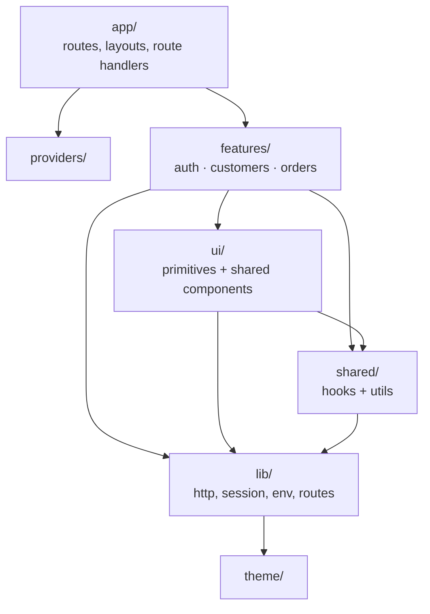
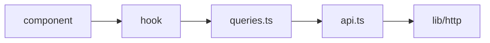
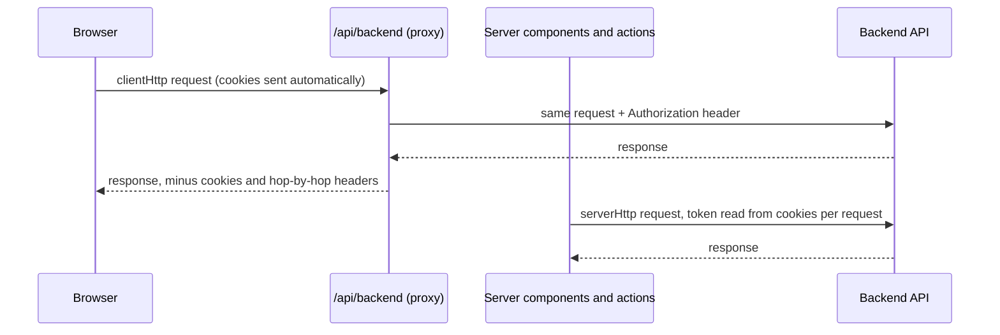

# Architecture

This document explains how the code is organised, how a request travels
through the app, and why the main decisions were made.

## Layers

Code lives in layers, and imports only point downwards.



| Layer | Holds | Must not |
|---|---|---|
| `app/` | routes, layouts, route handlers | contain business logic |
| `features/` | everything for one business area | import another feature's internals |
| `ui/` | design-system components | know about features or data fetching |
| `shared/` | generic hooks and helpers | contain business logic |
| `lib/` | infrastructure: HTTP, session, env | import features or UI |

Biome enforces the important rules: features import each other only through
`index.ts`, `ui`, `lib` and `shared` never import features, and features never
import the mock backend.

## Inside a feature

Every feature has the same parts:

| File | Job |
|---|---|
| `types.ts` | what the backend returns |
| `api.ts` | backend calls; take the HTTP instance as an argument |
| `queries.ts` | query keys and `queryOptions` |
| `schemas.ts` | form validation (Zod) |
| `constants.ts` | values the feature reuses |
| `hooks/` | one hook per file: queries and mutations |
| `components/` | the feature's UI |
| `index.ts` | the public API: the only file other code imports |

Data flows in one direction:



Components never call `api.ts` or the HTTP client directly.

## How a feature grows

A feature starts with flat files. A file becomes a folder once it holds two
or more resources or passes about 300 lines, and the files inside get a
suffix. Each file grows on its own: `api.ts` can become a folder while
`constants.ts` stays a file.

```
features/customers/          features/orders/
  components/                  components/
  hooks/                       hooks/
  api.ts          ──grows──►   api/
  queries.ts                     orders.api.ts
  types.ts                       payments.api.ts
  schemas.ts                   queries/
  constants.ts                   keys.ts
  index.ts                       orders.queries.ts
                                 payments.queries.ts
                               types/
                                 order.types.ts
                                 payment.types.ts
                               utils/
                               constants.ts
                               index.ts
```

`orders` has no `schemas/` because it has no forms; folders appear only when
needed. A feature that keeps growing is split into two features rather than
nested deeper. Other features import it through `index.ts`, so these moves
never break code outside the feature.

The same "second use" rule applies to components: `Pagination` lived in
`customers` until `orders` needed it, then moved to `ui/components`.

## Requests and auth

Tokens live in httpOnly cookies, so browser JavaScript never sees them.



- **Two HTTP instances.** `serverHttp` calls the backend directly from server
  components and actions. `clientHttp` runs in the browser and goes through
  the proxy, which adds the token.
- **Sign-in and sign-out** are server actions, because only the server can
  write httpOnly cookies. The proxy rejects the login and refresh endpoints,
  so raw tokens can't be read from the browser.
- **Refresh.** On a 401, `clientHttp` calls `/api/auth/refresh` once and
  retries. Requests that fail at the same time wait for that same refresh.
  If refreshing fails or the session was revoked, the user goes to login.
- **Protected pages.** `proxy.ts` redirects signed-out users early, and the
  `(app)` layout checks again on the server.

## Data and state

| State | Where |
|---|---|
| Server data | TanStack Query, never copied into a store |
| Filters, search, page | the URL |
| Local UI | `useState` |
| Theme | next-themes |
| Global client state | Zustand, added only when needed |

Server pages prefetch with the same `queryOptions` the client hooks use, so
the first render has data and the client reuses it instead of fetching again.
For this to work, the page and the hook must build the same query key; the
customers feature shares one `parseCustomerFilters` function between them.

## Mock backend

With `API_MOCKING=enabled`, the route handler at `app/api/mock` serves MSW
handlers over real HTTP and `API_URL` points at it. The proxy, cookies and
refresh flow all run exactly as they would against a real API, and the app
has no mock-specific code paths. Tests reuse the same handlers through
`setupServer`.

## Decisions and trade-offs

**Feature-based over Feature-Sliced Design.** FSD's extra layers (entities,
widgets, pages) and one slice per action pay off in large teams. Here they
would add many single-file folders. The one-way import rule and public
`index.ts` from FSD are kept because they cost nothing.

**A backend proxy for tokens.** Keeping tokens out of JavaScript protects
them from XSS, at the cost of one extra hop for browser requests.

**TanStack Query for server state.** It handles caching, deduplication,
retries and server prefetch, so there is no hand-written loading logic and
no server data copied into a client store.

**MSW served from a route handler.** Intercepting `fetch` in the Node
process stopped working after dev hot reloads, because Next restores its own
`fetch`. Serving the handlers over HTTP has no such problem and works the
same in development, production builds and deployments.

**Biome over ESLint and Prettier.** One fast tool for formatting and linting,
with the import rules the architecture depends on.

**No Content-Security-Policy yet.** A useful CSP needs per-request nonces
set in `proxy.ts`; a permissive one adds little. The other security headers
are set in `next.config.ts`.
